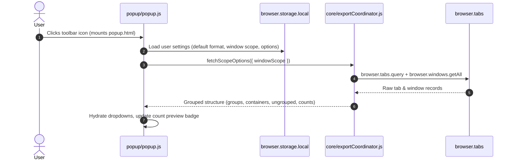
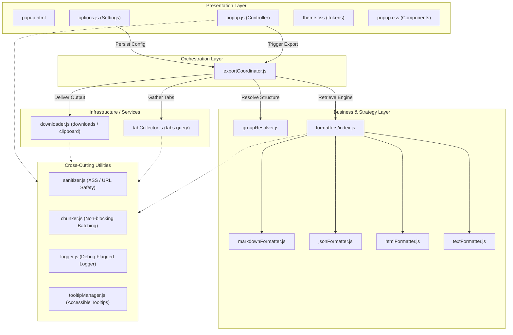

# Universal Developer Reference — Total Tab Exporter

> **Template Version**: 2.0.0  
> **Strict Lifecycle Rule**: This document is strictly for human developers, project owners, and maintainers. The AI agent **MUST NOT** load this document to learn how to write code (code must be self-explanatory). The agent reads and updates this file **ONLY AFTER** code changes have been implemented, tested, and verified working.

---

## 1. Project Overview & Metadata

| Field | Value | Notes |
| :--- | :--- | :--- |
| **Project Name** | Total Tab Exporter | Canonical application title |
| **Internal Codename / Moniker** | `totaltabsexporter` | Manifest namespace |
| **Version** | 1.2.0 | Semantic Versioning strictly enforced |
| **Release Stage** | Stable | Live on Firefox Add-ons (AMO) |
| **Tagline / Value Proposition** | Firefox extension to export open tabs to Markdown, JSON, HTML, or plain text with tab groups and containers | Fast, offline-first tab archiver |
| **Repository URL** | https://github.com/programer3/total-tabs-exporter | Primary upstream VCS link |
| **License** | MIT License | Open Source |
| **Primary Platforms** | Firefox WebExtensions (Manifest V3, Gecko $\ge 139.0$) | Browser Extension |
| **Primary Languages & Runtimes** | JavaScript (ESM, ES2022), CSS3 (OKLCH), HTML5 | Client-side runtime |
| **Owner / Lead Architect** | Total Tab Exporter Contributors | Maintainers & Community |

### 1.1 Executive Summary & Core Workflows
Total Tab Exporter is a lightweight Firefox extension that allows power users and developers to save and export open browser tabs into beautifully structured formats. It features window-aware scope filtering (current window, all windows, specific window), Firefox Multi-Account Container grouping, native Tab Group detection (Firefox 139+), same-domain filtering with auto-detection of the current page domain, and plain/formatted text output (Markdown, JSON, HTML, plain text).

The UI features a clutter-free 2-Tier Segmented Category Navigation (`[All]`, `[Page]`, `[Domain]`, `[Group]`, `[Container]`) with automatic pre-selection based on active tab context, seamlessly handling browser sessions with hundreds of tabs and domains.

The extension is 100% offline-first, requires no external host permissions, makes zero network calls, and features an asynchronous chunked engine capable of processing batches of over 1,000 tabs without dropping frames or freezing the browser.

### 1.2 Target Audience & Usage Personas
- **Primary Persona**: Developers, researchers, and tab hoarders who group tabs across multiple windows and containers and need to share links or back up open research sessions.
- **Secondary Persona**: Power users who want quick, one-click clipboard copying of current window URLs.

### 1.3 Browser & Platform Compatibility Matrix
| Browser / Platform | Minimum Version | Support Level | Technical Notes |
| :--- | :--- | :--- | :--- |
| **Mozilla Firefox (Desktop)** | **$\ge 139.0$** | **Full Native Support** | Native MV3, `browser.tabGroups` permission, Multi-Account Containers, Promise-based `browser.*` APIs. |
| **Firefox ESR** | **$\ge 140$ ESR** | **Full Native Support** | Legacy 115/128 ESR do not implement `browser.tabGroups` WebExtension API. |
| **Firefox for Android** | N/A | Unsupported | Android Gecko lacks `contextualIdentities` & `tabGroups` WebExtension APIs. |
| **Google Chrome / Chromium** | $\ge 111$ (via adapter) | Porting Required | Requires `webextension-polyfill` (`browser` -> `chrome`), `"service_worker"` in MV3 background, and omitting Firefox-exclusive `contextualIdentities`. |
| **Microsoft Edge** | $\ge 111$ (via adapter) | Porting Required | Same requirements as Google Chrome. |
| **Brave / Opera / Vivaldi** | $\ge 111$ (via adapter) | Porting Required | Same Chromium engine requirements as Chrome. |
| **Apple Safari** | $\ge 16.4$ (via Xcode) | Porting Required | Supports OKLCH, but lacks `tabGroups` and `contextualIdentities` WebExtension APIs. |

---

## 2. Mandatory Project-Owner Constraints ("DO NOT BREAK")

- **100% Offline Invariant**: Zero external network requests, zero remote scripts, zero telemetry. Never add external `@import` stylesheets or scripts.
- **Permission Minimization**: No host permissions (`<all_urls>` is strictly forbidden). The extension only reads metadata from tabs the browser already manages.
- **Strict Content Security Policy**: `default-src 'self'; script-src 'self'; style-src 'self'; img-src 'self' data: https:;`.
- **Output Sanitization**: All tab URLs must be sanitized before output generation; `javascript:` and `data:` URIs must be neutralized to prevent XSS.
- **Architecture Boundaries**: Presentation controllers (`popup.js`, `options.js`) must never perform raw formatting or download I/O directly; all actions flow through `core/exportCoordinator.js`.

---

## 3. Runtime Boot Lifecycle & Concurrency Architecture

### 3.1 Boot Sequence (Popup Mount Pipeline)


### 3.2 Graceful Shutdown Procedure
- When the extension popup loses focus, Firefox destroys the popup execution context.
- In-flight clipboard operations complete synchronously; file downloads are handed off to the browser's download manager via `browser.downloads.download`.
- Object URLs are safely revoked via delayed timeouts with unref'd handlers to prevent memory leaks.

### 3.3 Execution Topology & Concurrency Mechanics
- **Single-Threaded Event Loop**: Asynchronous operations yield to the event loop via `chunkProcess` (`utils/chunker.js`) every 50 items to keep popup animations fluid during large 1,000+ tab exports.
- **Background Worker**: `background/service-worker.js` listens for global keyboard shortcuts (`Ctrl+Shift+E`) and context menu clicks to open the popup.

---

## 4. Architectural Blueprint & Layer Isolation Diagrams

### 4.1 Chosen Pattern & System Topology
The codebase follows a Layered Clean Architecture pattern separating presentation, orchestration, domain strategies, and browser infrastructure.

### 4.2 System Architecture Diagram


### 4.3 Layer Isolation Contract
| Layer | Permitted Inward Imports | Forbidden Inward Imports | Responsibilities |
| :--- | :--- | :--- | :--- |
| **Presentation** (`popup/`, `options/`) | `core/exportCoordinator.js`, `utils/*` | `formatters/*`, `browser.downloads` directly | UI rendering, user interaction, DOM event binding |
| **Orchestration** (`core/exportCoordinator.js`) | `core/*`, `formatters/*`, `utils/*` | `popup/*`, `options/*` | Pipeline orchestration: gather -> filter -> format -> deliver |
| **Business / Formatters** (`formatters/`) | `utils/sanitizer.js`, `utils/chunker.js` | `browser.*` APIs, DOM elements | Pure text transformation according to format specs |
| **Infrastructure** (`core/tabCollector.js`, `core/downloader.js`) | `browser.*` APIs, `utils/*` | Presentation views, HTML documents | Raw WebExtension API access |

---

## 5. Complete Directory Tree & Code Map

```
ffox-extn-tabs-export/
├── .github/
│   └── workflows/
│       └── ci.yml                 # Automated CI: lint, test, package
├── .rules/                        # Universal rules & engineering OS
│   ├── RULES.md                   # Master rules manifest
│   ├── adapters/                  # Harness compatibility adapters
│   ├── architecture/              # Architectural invariants & principles
│   ├── conventions/               # Naming, styling, zero-warning standards
│   ├── design/                    # Universal Design System (Material 3 Orange, OKLCH)
│   ├── review-team/               # 12-role virtual review team rubrics
│   ├── sdlc/                      # Testing pyramid, security, CI/CD
│   ├── skills/                    # Portable core engineering skills
│   └── templates/                 # Universal project blueprints
├── _locales/
│   └── en_US/
│       └── messages.json          # English translation strings
├── background/
│   └── service-worker.js          # MV3 background worker (context menu & shortcuts)
├── core/
│   ├── downloader.js              # Blob generation, file download & clipboard copy
│   ├── exportCoordinator.js       # End-to-end pipeline coordinator
│   ├── groupResolver.js           # Tab group & container contextual sorting
│   └── tabCollector.js            # Raw browser tab query & normalization
├── formatters/
│   ├── htmlFormatter.js           # Standalone styled HTML document generator
│   ├── index.js                   # Strategy factory & registry
│   ├── jsonFormatter.js           # Structured JSON serializer with favicons
│   ├── markdownFormatter.js       # Clean Markdown link builder
│   └── textFormatter.js           # Plain text list generator
├── icons/
│   ├── icon-48.png
│   └── icon-96.png
├── options/
│   ├── options.css                # Options page styling
│   ├── options.html               # Options UI structure
│   └── options.js                 # Settings persistence controller
├── popup/
│   ├── popup.css                  # Popup component styles
│   ├── popup.html                 # Main popup widget layout
│   ├── popup.js                   # Presentation event controller
│   └── theme.css                  # OKLCH tokens & typography
├── tests/
│   ├── integration/
│   │   └── exportFlow.test.js     # End-to-end export pipeline tests
│   ├── mocks/
│   │   └── browser.mock.js        # Mock WebExtension APIs for Jest
│   └── unit/
│       ├── chunker.test.js        # Array chunking & async batch tests
│       ├── downloader.test.js     # Download & clipboard unit tests
│       ├── formatters.test.js     # Formatter output & sanitization tests
│       ├── groupResolver.test.js  # Scope resolution & group indexing tests
│       ├── sanitizer.test.js      # URL safety & HTML escaping tests
│       ├── tabCollector.test.js   # Filtering & tab query tests
│       └── tooltipManager.test.js # Tooltip positioning & boundary tests
├── utils/
│   ├── chunker.js                 # Non-blocking async chunking utility
│   ├── logger.js                  # Console logger enabled by debug flag
│   ├── sanitizer.js               # Escaping & URL scheme validation
│   └── tooltipManager.js          # Dynamic accessible tooltip positioning
├── .cursorrules                   # Cursor IDE instruction pointer
├── .eslintrc.json                 # ESLint rules & environment config
├── .gitattributes                 # Line endings configuration
├── .gitignore                     # Git exclusion rules
├── .web-ext-config.mjs            # Package build configuration
├── AGENTS.md                      # Universal root agent operating pointer
├── CONTRIBUTING.md                # Contribution workflow
├── DEVELOPER_REFERENCE.md         # Living developer reference (this file)
├── Development.md                 # Developer setup & testing guide
├── LICENSE                        # MIT License
├── manifest.json                  # WebExtension Manifest V3 specification
├── memory-bank.md                 # Single-file compact memory bank & progress log
├── package.json                   # Dependencies, scripts & Jest config
├── README.md                      # Public project overview
└── SECURITY.md                    # Vulnerability reporting policy
```

---

## 6. Storage & State Management

- **Storage Target**: `browser.storage.local`.
- **Key**: `tabExporterSettings`.
- **Schema**:
  ```typescript
  interface AppSettings {
    defaultFormat: 'markdown' | 'json' | 'html' | 'text';
    includeTitle: boolean;
    filterInternal: boolean;
    defaultOutput: 'download' | 'clipboard';
    defaultWindow: 'current' | 'all' | string;
  }
  ```
- **Lifecycle**: Loaded asynchronously when `popup/popup.js` or `options/options.js` mounts. Defaults are merged for any missing keys to prevent schema corruption.

---

## 7. API Specifications, Protocols & Contracts

### 7.1 Formatter Strategy Interface
Every formatter implements the unified strategy contract:
```javascript
interface IFormatter {
  format(groupedTabs: GroupedTabs, options?: { includeTitle?: boolean }): Promise<string>;
}
```

### 7.2 GroupedTabs Data Model
```typescript
interface GroupedTabs {
  all: NormalizedTab[];
  groups: Record<string, { meta: { name: string; color: string }; tabs: NormalizedTab[] }>;
  containers: Record<string, { meta: { name: string; color: string }; tabs: NormalizedTab[] }>;
  domains: Record<string, { domain: string; count: number; tabs: NormalizedTab[] }>;
  currentDomain: string | null;
  ungrouped: NormalizedTab[];
  windows: Array<{ id: number; title: string; count: number; activeTitle: string }>;
  currentWindowId: number;
  totalWindows: number;
}
```

---

## 8. Security, Auth & Data Governance Engine

- **Content Security Policy**: Hardened against inline scripts and remote CDN imports.
- **Sanitization Strategy** (`utils/sanitizer.js`):
  - `escapeHtml`: Converts `&`, `<`, `>`, `"`, `'` to safe HTML entities.
  - `escapeMarkdown`: Escapes Markdown control characters (`[`, `]`, `(`, `)`, `*`, `_`, etc.).
  - `sanitizeUrl`: Rejects `javascript:`, `vbscript:`, and `data:` protocols; falls back to `about:blank`.
- **Zero-Telemetry Protocol**: The extension contains zero trackers, analytics beacons, or remote loggers.

---

## 9. Error Handling, Logging & Telemetry Protocols

- **Error Resilience**: User-facing exceptions in popup operations display non-intrusive status banners via `showStatus(msg, isError)`.
- **Logger Protocol** (`utils/logger.js`):
  - Active only when `localStorage.getItem('TAB_EXPORTER_DEBUG') === '1'`.
  - Prefixed with `[TabExporter]`.
  - Complies with ESLint zero-warning policy.

---

## 10. Performance Invariants & Resource Budgets

- **Batch Size Gate**: Must export 1,000 tabs in $< 3,000\text{ms}$.
- **Main Thread Yielding**: `chunkProcess` processes tabs in slices of 50 items, yielding to the event loop via `setTimeout(..., 0)` to prevent UI thread lock.
- **Memory Disposal**: Blob URLs created for file downloads are revoked promptly via timers with `.unref?.()` to prevent leaks during test execution.

---

## 11. Testing & Verification Strategy

- **Test Framework**: Jest with `--experimental-vm-modules` for native ESM.
- **Coverage Target**: $\ge 80\%$ statement, $\ge 80\%$ functions, $\ge 70\%$ branch coverage.
- **Browser Mocking**: `tests/mocks/browser.mock.js` provides deterministic mock stubs for `browser.tabs`, `browser.windows`, `browser.tabGroups`, `browser.contextualIdentities`, `browser.downloads`, `browser.storage`, and `navigator.clipboard`.
- **Commands**:
  ```bash
  npm run lint       # Zero warnings policy
  npm test           # Full unit and integration suite with coverage
  npm run package    # web-ext build validation
  ```

---

## 12. CI/CD, Packaging & Release Engineering

- **Continuous Integration & Release Workflow** (`.github/workflows/ci.yml`):
  - **Triggers**: Runs strictly on `push` to `main` and git tags (`v*`). Pull request events are omitted to conserve runner minutes.
  - **Path Filters**: `paths-ignore` bypasses CI runs on markdown files (`**.md`), documentation (`docs/**`), screenshots, licenses, and agent configurations.
  - **Concurrency Defense**: `concurrency.cancel-in-progress: true` immediately aborts redundant runs when multiple commits are pushed in rapid succession.
  - **Resource Budgets & Timeouts**: `timeout-minutes: 10` enforces fail-fast protection against runaway runner jobs. Single consolidated job eliminates multiple VM spin-up penalties.
  - **Release Automation**:
    - Asserts version parity between `manifest.json` and `package.json`.
    - Packages the extension into `dist/total_tab_exporter-<version>.zip`.
    - Validates extension package using `web-ext lint`.
    - Idempotently creates a GitHub Release with attached `.zip` distribution via native `gh release create` if `v<version>` does not already exist. If the release already exists, it gracefully logs a skip notice without failing.
- **Supply Chain & Caching**: `package-lock.json` is tracked in git to guarantee deterministic installs via `npm ci` and fast npm caching via `actions/setup-node@v4`.
- **Exclusion Filters**: Non-runtime developer files, tests, documentation, and icons are excluded by `.web-ext-config.mjs`.

---

## 13. Local Development & Onboarding Playbook

1. Clone repository and install dependencies: `npm install`.
2. Run test suite: `npm test`.
3. Launch live reload development instance: `npm run dev`.
4. Inspect popup UI in temporary Firefox profile.

---

## 14. Practical Gotchas & Tribal Knowledge

1. **Jest ESM on Windows**: Running Jest through binary wrappers in `.bin` often breaks ESM loaders on Windows. Always run via `node --experimental-vm-modules node_modules/jest/bin/jest.js`.
2. **Native URL Constructor in Node**: When setting up mock environments, never overwrite `global.URL` directly as it breaks Node's internal URL parser. Attach mock methods (`createObjectURL`, `revokeObjectURL`) to the existing constructor.
3. **Active Tab Query**: `browser.tabs.query({ active: true, currentWindow: true })` returns an array. The active page tab is always index 0.
4. **Firefox Tab Group API Limitation**: The `browser.tabGroups` API is partially restricted in certain Firefox builds; `groupResolver.js` provides fallback group IDs when titles are unexposed.
5. **Jest Dot Notation in `toHaveProperty`**: Jest's `expect(obj).toHaveProperty('a.b')` treats dots as nested property paths (`obj.a.b`). For keys containing dots (such as domain names `example.com`), always pass an array: `expect(obj).toHaveProperty(['example.com'])` or test `expect(obj['example.com']).toBeDefined()`.
6. **Jest Mock Reset Hygiene**: `mockClear()` only clears call history. If a test overrides `mockResolvedValue()`, it persists across subsequent tests unless `mockReset()` and `mockImplementation()` are invoked in `beforeEach`.
7. **Firefox Minimum Version (`strict_min_version`)**: Mozilla's WebExtensions engine introduced official support for `"permissions:tabGroups"` in Firefox 139.0. Setting `strict_min_version` lower than 139.0 triggers web-ext linter warnings and API incompatibilities.
8. **Chromium Compatibility Nuances**: Chromium requires `"background": { "service_worker": ... }` instead of `"scripts"`, lacks the `contextualIdentities` permission, and requires the `chrome.*` namespace or `webextension-polyfill`.
