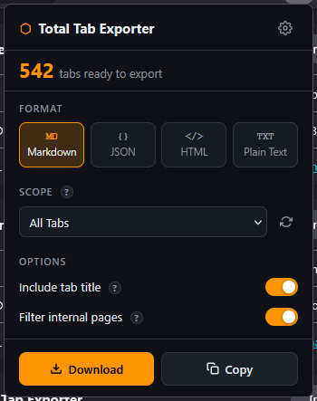

# Total Tabs Exporter — Firefox Extension

> Export all your Firefox tabs to **Markdown, JSON, HTML, or plain text** in one click.  
> Supports native tab groups (Firefox 139+), Multi-Account Containers, same-domain filtering, 1000+ tabs, and one-click clipboard copy.

---

## Features

| Feature | Description |
| :--- | :--- |
| **4 Export Formats** | Markdown, JSON (with favicons), self-contained HTML, plain text |
| **Window Aware** | Export from current window only, all open windows, or any specific window |
| **Tab Groups Support** | Firefox 139+ native tab groups with graceful degradation |
| **Container Support** | Full Firefox Multi-Account Container support |
| **Domain Scope** | Export all tabs matching a specific domain or the active page's domain |
| **Flexible Scope** | 2-tier navigation: All tabs / active page / domain / tab group / container |
| **Smart Filtering** | Option to exclude internal pages (`about:`, `moz-extension:`, etc.) |
| **Clipboard Integration** | One-click copy to clipboard instead of file download |
| **Auto-generated Filenames** | `firefox-tabs-export-YYYY-MM-DD-HH-MM-SS.ext` |
| **Persistent Settings** | Your preferences survive browser restarts |
| **High Performance** | Handles 1000+ tabs asynchronously without freezing your browser |
| **Privacy-First & Offline** | 100% offline, zero data collection, zero external network calls |

---

## Browser & Version Compatibility Matrix

| Browser / Platform | Minimum Supported Version | Compatibility Status | Feature Availability & Technical Notes |
| :--- | :--- | :--- | :--- |
| **Mozilla Firefox (Desktop)** | **$\ge 139.0$** | **Full Native Support** | Native Manifest V3, official `tabGroups` permission, Multi-Account Containers (`contextualIdentities`), offline OKLCH styling. |
| **Firefox ESR** | **$\ge 140$ ESR** | **Full Native Support** | Legacy ESR builds (115/128 ESR) lack the `tabGroups` WebExtension API. |
| **Firefox for Android** | N/A | Unsupported | Android Gecko does not expose `contextualIdentities` or native `tabGroups` WebExtension APIs. |
| **Google Chrome / Chromium** | $\ge 111$ (with adapter) | Porting Required | Requires `webextension-polyfill` (`browser` $\rightarrow$ `chrome`), `"service_worker"` background syntax in MV3, and omitting Firefox-exclusive `contextualIdentities`. |
| **Microsoft Edge** | $\ge 111$ (with adapter) | Porting Required | Same Chromium engine requirements as Google Chrome. |
| **Brave / Opera / Vivaldi** | $\ge 111$ (with adapter) | Porting Required | Chromium-based engines; same porting requirements. |
| **Apple Safari** | $\ge 16.4$ (with Xcode) | Porting Required | Requires Safari Web Extension converter; Safari lacks container and native tab group WebExtension APIs. |

---

---

## Installation

### From Firefox Add-ons (AMO) — Recommended

[Install Total Tabs Exporter on AMO](https://addons.mozilla.org/en-US/firefox/addon/total-tabs-exporter)

1. Visit [Firefox Add-ons](https://addons.mozilla.org/).
2. Search for "Total Tabs Exporter".
3. Click "Add to Firefox".

### Manual Installation (Sideloading)
1. Download the extension package (`.xpi` file) from the [Releases](https://github.com/programer3/total-tabs-exporter/releases) page.
2. Open Firefox and navigate to `about:addons`.
3. Click the Gear icon -> "Install Add-on From File...".
4. Select the downloaded `.xpi` file.

---

## Usage Guide

### Basic Export
1. Click the **Total Tab Exporter** icon in your Firefox toolbar.
2. Choose your preferred **Format** (MD / JSON / HTML / TXT).
3. If multiple windows are open, choose the **Window** to export:
   - **This Window**: Export only tabs open in the active window.
   - **All Windows**: Export all open tabs across all browser windows.
   - **Specific Window**: Export tabs from a particular window.
4. Select the **Scope** of tabs to export:
   - **All Tabs**: All tabs within the selected window scope.
   - **This Page**: Only the current active webpage tab.
   - **Current Group**: Tabs in your active tab group (Firefox 139+).
   - **Specific Container**: Tabs from a particular container.
   - **Ungrouped Only**: Tabs not in any group.
5. Toggle **Include tab title** to control title headers.
6. Toggle **Filter internal pages** to exclude Firefox system pages.
7. Click **Download** to save as a file, or **Copy** to copy directly to the system clipboard.

### Advanced Features
- **Settings Page**: Click the Gear icon in the popup header to access persistent preferences.
- **Context Menu**: Right-click on any page for quick export access.
- **Keyboard Shortcut**: Press `Ctrl+Shift+E` to launch the exporter.

---

## Security & Privacy

- **No Host Permissions**: Only accesses tab metadata; never injects content scripts into web pages.
- **Zero Network Calls**: All processing happens locally on your device.
- **Strict Content Security Policy**: Blocks inline scripts and external code execution.
- **URL Sanitization**: Automatically blocks dangerous URLs like `javascript:` and `data:` schemes.
- **No Data Collection**: Your browsing data never leaves your device.
- **Open Source**: Code is publicly auditable for security review.

**Minimal Required Permissions:**
- `tabs`: Read tab information.
- `tabGroups`: Detect native Firefox 139+ tab groups.
- `contextualIdentities`: Access container information.
- `downloads`: Save export files to disk.
- `clipboardWrite`: Copy tab listings to clipboard.
- `storage`: Save user configuration persistently.

---

## Architecture & Code Quality

The codebase conforms to the universal engineering standards in [`.rules/RULES.md`](.rules/RULES.md) and SOLID design principles:

- **Manifest V3**: Latest Firefox WebExtension specification.
- **Layered Clean Architecture**: Strict decoupling of Presentation, Orchestration, Business Domain, and Services.
- **Material 3 Orange & OKLCH**: Perceptually uniform color tokens with 100% offline system typography.
- **Async Batching**: Non-blocking event-loop yielding for large tab sets (1,000+ tabs).

---

## Documentation

- [Developer Reference](DEVELOPER_REFERENCE.md) — 14-section Beast PRD, Mermaid diagrams, API specs, and gotchas.
- [Development Playbook](Development.md) — Complete setup, testing, and AMO publishing guide.
- [Memory Bank & Changelog](memory-bank.md) — Project charter, execution progress, and semantic release notes.
- [Contributing Guidelines](CONTRIBUTING.md) — Git workflow and pull request guidelines.
- [Security Policy](SECURITY.md) — Vulnerability reporting and security directives.

---

## License

Distributed under the MIT License. See [LICENSE](LICENSE) for more information.
